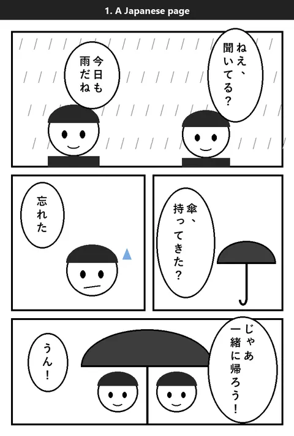
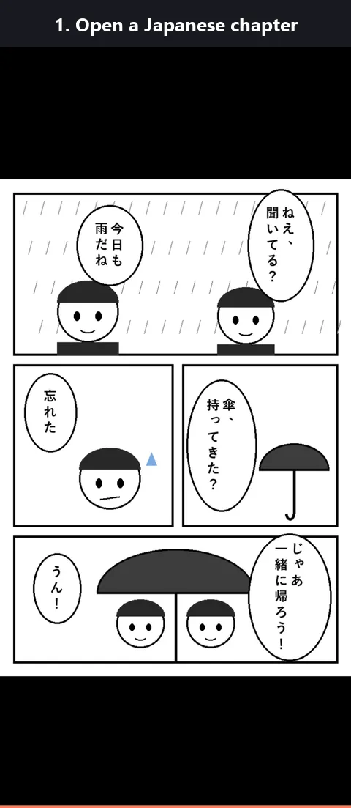

# Manga Translate for MangaVibe

Read Japanese manga in English. While you read in [MangaVibe](https://github.com/ivokolarov0/manga-vibe),
English text appears on top of the Japanese speech bubbles.

**How it works, in one sentence:** MangaVibe (wherever it runs) sends each page to your **computer**,
your computer finds the text, reads it and translates it, and sends the English back. Each page is
translated only once and then saved.

<p align="center"></p>
<p align="center"><sub>A made-up test page, translated by the small <code>manga-translate</code> model.</sub></p>

**Free and private.** Everything runs on your own computer: no account, no subscription, no AI
service on the internet, and your manga never leaves your home network. The internet is only used
once, to download the programs and models.

**What you install:** two programs, which together use three small AI models. That's normal: each
model does one job. (Why not one big model for everything? See [Why three models?](#why-three-models))

| Program | Its models | Job |
|---|---|---|
| **Ollama** | one translation model, which you pick in step 3 | turns Japanese into English |
| **The text reader** (in this folder) | two tiny models it downloads by itself | finds the speech bubbles, reads the Japanese |

So you need:

- **MangaVibe 1.7.0 or newer**, on any machine: a NAS, a home server, or the same computer
- **A computer with a graphics card**, on the same home network. It must be switched on while you
  read new chapters.
  - **Windows:** NVIDIA, AMD or Intel graphics, 4 GB or more
  - **Mac:** Apple Silicon (M1 or newer), 8 GB of memory or more
  - **Linux:** NVIDIA or AMD graphics, 4 GB or more

> **Tested on Windows only.** Mac and Linux should work the same way, but nobody has tried them yet,
> so there may be problems. If something goes wrong, please
> [open an issue](https://github.com/ivokolarov0/manga-vibe-ext-translate/issues) and say which system
> you use and what the window showed.

Setting it up takes about 15 minutes, once.

---

## Part 1: on your computer

You will install two programs and download one folder. Each step says what to do on **Windows**,
**Mac** and **Linux**; do only the part for your system.

### Step 1: Download this plugin

1. At the top of this page, click the green **Code** button → **Download ZIP**.
2. Unzip it, for example to:
   - **Windows:** `C:\MangaTranslate`
   - **Mac / Linux:** a folder called `MangaTranslate` in your home folder (`~/MangaTranslate`)

You'll use this folder in the next steps.

### Step 2: Install Ollama (it translates)

- **Windows:** go to [ollama.com](https://ollama.com), click **Download**, run the installer. A small
  llama icon appears in the system tray (bottom right, near the clock).
- **Mac:** go to [ollama.com](https://ollama.com), click **Download**, open the file and drag Ollama
  into **Applications**. Start it once; a llama icon appears in the menu bar (top right).
- **Linux:** open a terminal and run:
  ```
  curl -fsSL https://ollama.com/install.sh | sh
  ```
  It installs Ollama as a service that starts by itself.

### Step 3: Download the translation model

1. Open a command window:
   - **Windows:** press the **Windows key**, type `cmd`, press **Enter**. A black window opens.
   - **Mac:** open **Applications → Utilities → Terminal**.
   - **Linux:** open a terminal.
2. How much memory does your graphics card have?
   - **Windows:** press Ctrl+Shift+Esc → **Performance** → **GPU** → "Dedicated GPU memory".
   - **Mac:** Apple menu → **About This Mac** → "Memory" (the Mac shares it with the graphics).
   - **Linux (NVIDIA):** run `nvidia-smi`; it's the number after the `/` in the memory column.
3. Pick one:
   - **8 GB or more of graphics memory (Mac: 16 GB or more):** type this and press Enter. It
     downloads about 6 GB.
     ```
     ollama pull gemma4
     ```
   - **Less than that:** go to the plugin folder first, then create the small model. It downloads
     about 1 GB.
     ```
     cd C:\MangaTranslate                          (Windows)
     cd ~/MangaTranslate                           (Mac / Linux)
     ollama create manga-translate -f Modelfile
     ```
4. Wait until it says **success**. Remember which one you picked: `gemma4` or `manga-translate`.

   Only `gemma4` can do [full context](#full-context-who-says-what) translation, which keeps track
   of the story and who speaks. `manga-translate` translates page by page.

### Step 4: Let MangaVibe talk to Ollama

Ollama only talks to programs on the computer itself, until you change one setting. (You can skip
this step only if MangaVibe runs on this same computer **without** Docker; see
[MangaVibe on the same computer](#mangavibe-on-the-same-computer).)

- **Windows:**
  1. Press the **Windows key**, type `environment`, click **Edit environment variables for your account**.
  2. Under the top list, click **New…**
  3. **Variable name:** `OLLAMA_HOST`  **Variable value:** `0.0.0.0`  → **OK** → **OK**.
  4. Right-click the llama icon in the tray → **Quit Ollama**. Then start **Ollama** again from the Start menu.
- **Mac:**
  1. In Terminal, run:
     ```
     launchctl setenv OLLAMA_HOST "0.0.0.0"
     ```
  2. Click the llama icon in the menu bar → **Quit Ollama**, then start Ollama again from Applications.
  3. A Mac forgets this when it restarts: after restarting the Mac, do this step again.
- **Linux:**
  1. Run:
     ```
     sudo systemctl edit ollama
     ```
  2. In the editor that opens, add these two lines in the empty space near the top, then save and close:
     ```
     [Service]
     Environment="OLLAMA_HOST=0.0.0.0"
     ```
  3. Run:
     ```
     sudo systemctl restart ollama
     ```

### Step 5: Install uv (it runs the text reader)

- **Windows:** press the **Windows key**, type `powershell`, press **Enter**. In the blue window,
  paste this line and press **Enter**:
  ```
  powershell -ExecutionPolicy ByPass -c "irm https://astral.sh/uv/install.ps1 | iex"
  ```
- **Mac / Linux:** in a terminal, run:
  ```
  curl -LsSf https://astral.sh/uv/install.sh | sh
  ```

Then **close the window** and use a new one from now on (the new command only works in new windows).

### Step 6: Start the text reader

This is the part that finds the speech bubbles and reads the Japanese.

1. Open a command window in the plugin folder:
   - **Windows:** open the `C:\MangaTranslate` folder, click the address bar at the top of the folder
     window, type `cmd`, press **Enter**. A black window opens, already in the right folder.
   - **Mac / Linux:** open a terminal and run `cd ~/MangaTranslate`.
2. Type this and press **Enter**:
   ```
   uv run manga_vision_server.py
   ```
3. The first time, it downloads what it needs (a few minutes). Then it shows something like:
   ```
   Manga vision server 1.1.0 is running on GPU (DirectML).
   In MangaVibe, use this address:  http://192.168.1.50:7865
   ```
   **Write down that address.** The numbers in the middle (`192.168.1.50`) are your computer's
   address. (On a Mac it may say `Apple (CoreML)`, on Linux `CPU`. All of them are fine: reading the
   text is quick even without the graphics card.)
4. Allow it through the firewall:
   - **Windows:** when Windows asks, tick **Private networks** and click **Allow**.
   - **Mac:** if the Mac asks whether to accept incoming connections, click **Allow**.
   - **Linux:** only if you use a firewall (e.g. `ufw`): `sudo ufw allow 7865/tcp` and
     `sudo ufw allow 11434/tcp`.
5. **Leave this window open.** Closing it stops the translations. (Next time you only do this step 6.)

### Step 7 (recommended): Keep your computer's address the same

Your router may give the computer a different address after a restart, and then MangaVibe can't find
it. Open your router's settings page, find the list of devices, and choose **reserve IP** /
**static lease** / **DHCP reservation** for your computer. (Every router names it a little differently.)

---

## Part 2: in MangaVibe

### Step 8: Add the plugin

1. Copy `manga_translate.py` from the plugin folder into MangaVibe's **plugins** folder. It's
   inside MangaVibe's data folder: if you run MangaVibe in Docker, that's the folder you mounted as
   `/data`, so the file goes into `<that folder>/plugins`.
2. In MangaVibe, open **Settings → Plugins** and click **Reload plugins**.
   **Manga Translate** appears in the list.

### Step 9: Tell it where your computer is

Click **Settings** next to Manga Translate and fill in (use your own numbers from step 6):

| Box | What to type | Example |
|---|---|---|
| **Vision server** | the address from step 6 | `http://192.168.1.50:7865` |
| **LLM server** | the same numbers, but `:11434` at the end | `http://192.168.1.50:11434` |
| **Model** | what you picked in step 3 | `gemma4` or `manga-translate` |
| **Translation** | *Full context* with `gemma4`; *Page by page* with `manga-translate` | see [Full context](#full-context-who-says-what) |
| **Show the page to the model** | *On* with `gemma4` and full context (better guesses of who speaks) | see [Full context](#full-context-who-says-what) |

Leave the other boxes as they are. Click **Save**, then click **Test connection**.
It should say *Vision server OK · LLM server OK, model found*. If not, see
[Something doesn't work](#something-doesnt-work).

### MangaVibe on the same computer

If MangaVibe runs on the same computer as Ollama and the text reader, the addresses depend on how
you run MangaVibe:

- **MangaVibe in Docker** (the usual way): inside Docker, `localhost` means MangaVibe's own container,
  not your computer, so don't use it.
  - **Windows or Mac with Docker Desktop:** use `http://host.docker.internal:7865` and
    `http://host.docker.internal:11434`. This name always points at your computer, so step 7 isn't
    needed.
  - **Linux:** use the address the text reader prints (step 6), e.g. `http://192.168.1.50:7865` and
    `http://192.168.1.50:11434`, and do step 7.
  - Either way, **do step 4**: Docker counts as "another computer" for Ollama.
- **MangaVibe without Docker** (for example started with `python dev.py`): use
  `http://localhost:7865` and `http://localhost:11434`. Steps 4, 6.4 (firewall) and 7 aren't needed.

If **Test connection** says it can't reach one of them, check the firewall too (step 6.4).

---

## Part 3: reading

1. Open a Japanese chapter.
2. Tap the middle of the page, then the **☰** button (bottom corner) to open the reading options.
3. Switch **Translation** to **On**.

<p align="center"></p>
<p align="center"><sub>A made-up test page in MangaVibe on a phone, translated by <code>gemma4</code>.</sub></p>

The English appears after a second or two ("Translating…" shows at the top meanwhile). The next 8
pages are translated in the background, so turning pages doesn't wait. Translation stays on for this
series until you switch it off.

**Good to know:**

- **See the Japanese:** with a mouse, point at an English box.
- **Remove a wrong box:** tap the middle of the page; each box gets a small **×**. Tap it.
  *Show hidden boxes* in the reading options brings them back.
- **See the art through the boxes:** in the reading options, tap **Box background** until the boxes
  are as see-through as you like, and **Text outline** for a white outline that keeps the English
  readable. (The plugin's settings have the same two options.)

  <p align="center"></p>
- **Translate ahead of time:** in the reading options, **Translate this chapter**. Or on the series
  page, **Plugin tools → Translate the whole series** (chapter after chapter; the page you're reading
  always goes first).
- **See what's done:** chapters show **Translated**, **Translated · full context** or
  **Translated 12/40** in the series' book list.
- **A bubble isn't translated:** the text finder wasn't sure enough it was text. In the plugin's
  settings, set **Bubble detection** to **More** (or **Most**), then in the reader **Translate this
  chapter again**. It finds more bubbles, but also some wrong boxes: remove those with **×**. Too
  many wrong boxes? Set it back to **Normal**, or **Fewer**.
- **Better or different translation:** change the **Model** in the plugin's settings, then in the
  reader **Translate this chapter again**.
- **Names:** if a name keeps coming out wrong, add it under **Names and terms**, like
  `春香=Haruka; 先輩=senpai` (Japanese = English, separated by `;`).
- **Computer switched off?** Already translated pages still show. New pages wait, and the reader says
  *Can't reach the vision server*. When the computer and step 6 run again, it carries on by itself.

### Full context: who says what

Page by page, each page is translated on its own, so the model doesn't know who is talking, what
happened before, or who "that guy" is. With **Translation** set to **Full context** (in the plugin's
settings), each page goes to the model together with:

- the series' description (from MangaVibe's metadata),
- notes on the characters (Japanese name, English name, who they are, how they talk) and the story so far,
- the two pages before it, with who said what, and the page after it.

The model also says **who speaks each bubble**: point at an English box to see the name and the
Japanese. When a chapter is finished, the model updates the notes, and the next chapter starts from
them. So names, voices and references stay the same from chapter to chapter.

**Show the page to the model** (a second setting) makes the speaker guesses much better. The model
also gets the page picture, with each bubble framed and numbered, and first says whom each bubble
belongs to: the person its tail points to, or the one next to it. From the text alone it can only
guess, and in a back-and-forth it easily swaps two people. It also remembers how each character looks
("Haruka: brown hair, red bow"), so it knows them on later pages.

In the reader, tap the middle of the page: under the chapter's name it says how the page was
translated and who speaks on it, e.g. *Full context + picture · Haruka, Taro* (or *Page by page*).
This needs MangaVibe 1.12.0 or newer; on older versions everything else works, without this line.

- **Needs `gemma4`** (or a similar model; for the picture, one that can see pictures). With
  `manga-translate` the pages are still translated page by page, and **Test connection** says so.
- **Best in order:** the notes build up chapter by chapter. Use **Plugin tools → Translate the whole
  series** once, then read. A chapter you translate first, without the ones before it, has no notes yet.
- **Chapters translated before** stay as they are. In the reader, **Translate this chapter again**
  redoes one with full context.
- It's slower, since each page sends more to the model. Measured with `gemma4` on an RTX 5070 Ti, for
  short test pages (4–6 bubbles):

  | | per page |
  |---|---|
  | Page by page | about 0.3–0.4 s |
  | Full context | about 0.5–0.8 s |
  | Full context + picture | about 1.0–1.3 s (the first page after starting takes ~6 s more, once) |

### Every time you want to read new chapters

On the computer, do step 6 again: open a command window in the plugin folder and run
`uv run manga_vision_server.py`. Ollama starts by itself (on a Mac, check that the llama icon is in
the menu bar, and after a restart of the Mac redo step 4).

---

## How fast is it?

About how long one page takes (a typical page with around 6 speech bubbles). The 16 GB row was
measured on an RTX 5070 Ti; the other rows are estimates.

| Graphics memory | `manga-translate` | `gemma4` |
|---|---|---|
| **16 GB** (e.g. RTX 4070 Ti Super, 4080, 5070 Ti) | under 1 s | under 1 s (full context + picture: 2–3 s) |
| **12 GB** (e.g. RTX 3060 12 GB, 4070) | about 1 s | 3–5 s |
| **8 GB** (e.g. RTX 3060 Ti, 4060) | 1–2 s | 5–10 s (only just fits) |
| **4–6 GB** (e.g. GTX 1650, RTX 2060) | 2–4 s | not recommended: 20 s or more |
| **No graphics card**, recent desktop (8+ cores, DDR5 memory, e.g. Ryzen 7 7700, Core i7-13700) | 3–6 s | 15–25 s |
| **No graphics card**, older PC or laptop (4–6 cores, DDR4 memory) | 6–15 s | 40–80 s |

- **Memory (RAM):** the model has to fit in the computer's memory too. `manga-translate` needs 8 GB
  of RAM, `gemma4` 16 GB.
- **CPU and RAM speed matter** without a graphics card, and when the model doesn't fully fit on the
  card (`gemma4` on 8 GB or less): that part then runs on the CPU. Fast memory (DDR5, two sticks)
  helps more than extra cores.
- Most of the time is the translation; finding and reading the text takes under half a second
  (1–3 s on CPU only).
- **You usually only wait for the first page:** the next 8 are translated while you read.
- The first page after starting the computer takes a few seconds longer, while Ollama loads the model.
- **Mac:** Apple Silicon is roughly like the 8–12 GB rows. **AMD and Intel cards** are often a little
  slower than NVIDIA cards with the same memory.

## Why three models?

`gemma4` can see pictures, so it could do everything alone: look at the page, find the bubbles, read
them and translate them. We tried that, and it's slower and much worse. Measured on a Japanese manga
chapter (19 pages) on an RTX 5070 Ti. The three models found 86 speech bubbles; the table shows how
many of those the single model put a box on:

| | per page | Bubbles in the right place | Reads the Japanese | Translation |
|---|---|---|---|---|
| **Three models**, with `gemma4` | **0.65 s** | all 86 | almost always right | good, natural English |
| **Three models**, with `manga-translate` | 0.7 s | all 86 | almost always right | OK, often gets names and meaning wrong |
| **Three models**, with `gemma4:12b` | 1.2 s | all 86 | almost always right | good, about the same as `gemma4` |
| **Three models**, with `gemma4`, full context + picture | 2.3 s | all 86 | almost always right | good, and says who speaks |
| **`gemma4` alone** | 1.6 s | 38 of 86 | often wrong, bubbles cut into pieces | poor: bits like "To help", "Here" |
| **`gemma4:12b` alone** | 4.6 s | 47 of 86 | often wrong, sometimes makes up lines | poor: says things the page doesn't |

What goes wrong when one model does everything:

- **It can't say where the text is.** Its boxes land on faces and on empty background, so the English
  can't be put on top of the right bubble. That alone rules it out.
- **It misreads the Japanese**, and one wrong letter can turn a line into its opposite: "it hurts"
  became "I'm fine".
- **It makes things up:** when it can't read a bubble, it writes an English line that has nothing to
  do with the page.

With three models, the small ones do what they're good at, fast: one finds the bubbles, one reads the
Japanese (together under 0.2 s a page). The translation model then only has to translate clean text.
They aren't perfect either: now and then a bubble is missed, or two bubbles next to each other become
one box (remove a wrong box with **×**, see [Part 3](#part-3-reading); for missed bubbles, try
**Bubble detection** in the plugin's settings).

## Something doesn't work

| MangaVibe says | What to do |
|---|---|
| *Can't reach the vision server* | Is the window from step 6 still open? On your phone, open `http://<computer address>:7865/health`. If nothing loads: allow it through the firewall (step 6.4), or the computer's address changed (step 7). |
| *Can't reach the LLM server* | Step 4 wasn't done, or Ollama wasn't restarted after it. On a Mac, step 4 has to be redone after every restart. |
| Everything on one computer and it can't reach either server | Don't use `localhost` when MangaVibe runs in Docker: see [MangaVibe on the same computer](#mangavibe-on-the-same-computer). |
| *has no model called …* | The **Model** box must match step 3 exactly. In a command window, `ollama list` shows the names. |
| *set the server addresses in Settings* | Step 9. |
| No **Translation** switch in the reader | Step 8: is the plugin in the list, and switched on? MangaVibe must be 1.7.0 or newer. |
| `uv` is not recognized / not found | Close the window and open a new one (step 5 only works in new windows). |
| Very slow | Usually the translation. In a command window, `ollama ps` should say `100% GPU`. If it says `CPU`, the model is too big for the graphics card: use `manga-translate` (step 3). |

Mac or Linux and something else goes wrong? It hasn't been tested there yet, so it may be a bug:
please [open an issue](https://github.com/ivokolarov0/manga-vibe-ext-translate/issues).

## Try it without MangaVibe

Put a few manga pages in a folder. With the server from step 6 running, open a second command window
in the plugin folder and run:

```
uv run try_pages.py <path to the folder> --model gemma4
```

It makes `report.html` in that folder: every page with the English on top, and a list of what was
read and how it was translated.

To try full context, add `--context`, and `--notes notes.json` to keep the notes between chapters
(run it chapter after chapter with the same file):

```
uv run try_pages.py <chapter 1 folder> --model gemma4 --context --notes notes.json
uv run try_pages.py <chapter 2 folder> --model gemma4 --context --notes notes.json
```

Add `--picture` to show the pages to the model too. To see what **Bubble detection** changes, add
`--threshold 0.2` (More) or `--threshold 0.1` (Most); Normal is 0.3.

## What's in this folder

| File | What it is |
|---|---|
| `manga_translate.py` | the plugin; goes into MangaVibe's plugins folder |
| `manga_vision_server.py` | the text reader that runs on your computer (step 6) |
| `Modelfile` | settings for the small translation model (step 3) |
| `try_pages.py` | the test tool above |

**The three models:** Manga-Bubble-YOLO finds the text, manga-ocr-nar reads the Japanese, and Gemma 4
or Hy-MT2 translates. They are downloaded on first use. The text reading model is free for personal
use only (CC BY-NC-SA 4.0), **not for commercial use**.

## Legal

Manga Translate is a tool for reading manga **you own**, on your own computer. It doesn't include,
download or share any manga, and the translations are only shown to you, inside your own MangaVibe.

- Don't use it to share or publish translated pages.
- Please support the creators: buy the manga you read, and the official translations when they come out.

The models are made by others and downloaded from their authors on first use; each has its own
licence (see above). This project is provided as is, without any warranty.

**Licence:** the code in this repo is [MIT](LICENSE): use, change and share it freely. The models it
downloads are not part of it and keep their own licences.
